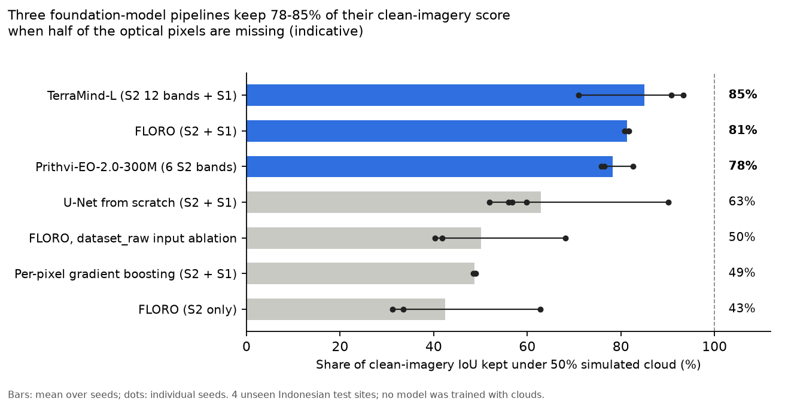

# FLORO-Tropis pilot: frozen geospatial foundation models for mangrove mapping in Indonesia

A first test of how well geospatial foundation models transfer to tropical, cloud-prone Indonesia, run by
[GEOAI](https://geoai.id) in November 2026 as groundwork for a larger study built on
[FLORO](https://github.com/jorlrodriguezg/floro) (KAUST). This is an independent study by GEOAI; it is not affiliated
with or endorsed by the FLORO authors.

**Question.** Do frozen foundation-model encoders (FLORO, TerraMind-L, Prithvi-EO-2.0-300M), each with a trained
segmentation head, map mangroves at unseen Indonesian sites better than a U-Net trained from scratch and a per-pixel
gradient-boosting model, on clean imagery and when optical data are missing?

**Short answer.** On clean imagery the U-Net and the three frozen-encoder pipelines could not be told apart. With half
of the optical pixels removed (simulated cloud on otherwise clear composites; no model trained with gaps), TerraMind-L
and FLORO with radar, and Prithvi without radar, kept 78-85% of their clean score, against 63% for the U-Net and 49% for
gradient boosting; FLORO without radar kept 43%. The advantage over the U-Net holds only for the three as a group and is
indicative: it is not significant for any single model. With optical data entirely missing, no model produced a usable
map.



## Results

Pooled mangrove IoU over 400 test patches (26,214,400 pixels) at 4 unseen sites, mean ± sd over training seeds.
The radar-only column reports Matthews correlation (MCC), because a constant all-mangrove map already scores 0.211 IoU.
Full tables (precision, recall, per-site and per-seed scores, site-mean IoU, IoU without Segara Anakan):
[results/summary.md](results/summary.md); its brackets are 95% patch-bootstrap intervals of the seed-mean pooled IoU
(stratified by site, 2000 draws), where per-patch counts exist. Statistics: `.venv/bin/python -I src/stats.py`.

| Model | Seeds | Clean | 50% simulated cloud | Optical missing (MCC) |
|---|---|---|---|---|
| Per-pixel gradient boosting (S2 + S1) | 3 | 0.759 ± 0.003 | 0.370 ± 0.001 | 0.10 ± 0.02 |
| U-Net from scratch (S2 + S1) | 5 | 0.795 ± 0.014 | 0.501 ± 0.132 | 0.05 ± 0.10 |
| FLORO frozen + head (S2 + S1) | 3 | 0.785 ± 0.012 | 0.639 ± 0.009 | 0.16 ± 0.10 |
| FLORO frozen + head (S2 only) | 3 | 0.769 ± 0.023 | 0.324 ± 0.124 | n/a (no input) |
| TerraMind-L frozen + head (S2 12 bands + S1) | 3 | 0.803 ± 0.013 | 0.683 ± 0.101 | 0.27 ± 0.15 |
| Prithvi-EO-2.0-300M frozen + head (6 S2 bands) | 3 | 0.779 ± 0.012 | 0.609 ± 0.035 | n/a (no radar) |
| Ablation: FLORO with `dataset_raw` input scaling | 3 | 0.701 ± 0.026 | 0.349 ± 0.103 | 0.21 ± 0.01 |
| Reference: radar-only gradient boosting | 3 | – | – | 0.20 |
| Reference: constant all-mangrove map | – | 0.211 | 0.211 | 0 |

### Findings

1. **Clean imagery: no measurable difference among the four main deep models.** The U-Net, FLORO (S2 + S1),
   TerraMind-L and Prithvi span 0.779 to 0.803 pooled IoU and no pair differs significantly (Welch p ≥ 0.07 on seed
   values). With 3 to 5 seeds the design cannot resolve gaps below about 0.03 to 0.04 IoU, so this is "not separable
   here", not demonstrated equivalence. The frozen encoders showed no advantage over a U-Net trained with one default,
   untuned configuration. Only the U-Net beats gradient boosting on every clean summary (pooled IoU p = 0.003,
   site-mean IoU p = 0.02, IoU without Segara Anakan p = 0.001). TerraMind-L and FLORO (S2 + S1) are higher in pooled
   IoU (p = 0.02 and 0.05) but not significantly in site-mean IoU (p = 0.14 and 0.25); Prithvi does not differ from
   gradient boosting (pooled p = 0.09).
2. **50% simulated cloud: three foundation-model pipelines degrade less than the U-Net, as a group (indicative).**
   TerraMind-L, FLORO (S2 + S1) and Prithvi kept 78-85% of their clean IoU; the U-Net kept 63% and gradient boosting
   49%. As a class the three beat the U-Net in 38 of 45 seed pairs (exact permutation test, p = 0.016), but none does so
   significantly on its own (same permutation test, p = 0.11 to 0.16). This grouping was made after seeing the results;
   FLORO without radar (43%) and the `dataset_raw` ablation (50%) degrade as much as the U-Net or more. FLORO is the
   most seed-consistent deep model here (sd 0.009); TerraMind-L has the highest mean and one weak seed.
3. **FLORO needs its radar input under cloud.** Without Sentinel-1, FLORO falls to 0.324 at 50% cloud, lower in all
   36 site-by-seed pairs. This may partly reflect how FLORO encodes fully missing optical tokens (not tested here)
   rather than a general need for radar: Prithvi has no radar and holds 0.609.
4. **Optical missing entirely: no usable map.** The best mean MCC is 0.27 ± 0.15 (TerraMind-L); every model's mean MCC
   is below that of a trivial map that marks only the Mimika site as mangrove (MCC 0.38; the best single TerraMind-L
   seed reaches 0.38). This pilot gives no evidence for mapping under persistent cloud.
5. **FLORO's own input normalisation matters.** Feeding physical units (the PANGAEA wrapper's `dataset_raw` mode)
   instead of FLORO's pretraining z-scores lowers IoU from 0.785 to 0.701 (clean) and 0.639 to 0.349 (cloud).
6. **Site difficulty dominates on clean imagery.** Every model except the `dataset_raw` ablation (0.305 at Segara
   Anakan) scores 0.81-0.90 at Kubu Raya and Mimika and 0.38-0.52 at Segara Anakan and Kendari (site explains about
   99% of the model-by-site variance). At Kendari about a third of the GMW 2020 mangrove pixels look like ponds or
   cleared land in 2019-2021 imagery (NDVI < 0.3), so part of that gap is label disagreement. Both hard sites lie on
   islands with no training site.
7. **The from-scratch U-Net's model selection is fragile.** One same-seed re-run with a different CPU thread count moved
   its clean IoU from 0.743 to 0.795 (early stopping kept epoch 2, then epoch 23). Re-runs of two frozen-encoder heads
   reproduced clean IoU within 0.006.

### Follow-up checks on a Colab GPU (November 2026)

[`colab/floro_c512.ipynb`](colab/floro_c512.ipynb) rebuilt everything from scratch on a Colab L4 GPU and trained the
FLORO (S2 + S1) head with the PANGAEA decoder width. Results: [results/colab/](results/colab/).

- **The data pipeline reproduces.** The rebuilt patches match the published index exactly (all patch rows identical,
  maximum difference 0.0 in mangrove share and valid-pixel share, train statistics within 9 × 10⁻⁷), and the FLORO
  weights have the same SHA-256.
- **A PANGAEA-size decoder does not help.** Same GPU, same seeds, 3 each:

  | FLORO (S2 + S1) head | Parameters | Clean | 50% cloud | Radar only (MCC) | Best epochs |
  |---|---|---|---|---|---|
  | 128 channels (published, CPU) | 8.7 M | 0.785 ± 0.012 | 0.639 ± 0.009 | 0.16 ± 0.10 | 17, 25, 5 |
  | 128 channels (GPU control) | 8.7 M | 0.779 ± 0.005 | 0.617 ± 0.036 | 0.13 ± 0.15 | 17, 29, 31 |
  | 512 channels (GPU, PANGAEA width) | 41.7 M | 0.770 ± 0.021 | 0.572 ± 0.075 | 0.29 ± 0.14 | 7, 7, 5 |

  Per-seed differences (512 minus 128, same seed) are mixed: clean −0.032, −0.007, +0.015; 50% cloud −0.168, +0.022,
  +0.011. The 512-channel head peaks within 5 to 7 epochs, so with 319 training patches the larger decoder mainly
  overfits sooner; it does not change any finding above. Its higher radar-only MCC comes with mapping 30% of the area as
  mangrove (truth 21%) and varies widely across seeds.
- **CPU and GPU agree within run-to-run noise** for the 128-channel head on clean imagery (0.785 vs 0.779); the 50%
  cloud score moves more (0.639 vs 0.617), in line with finding 7.

### Limitations and disclosures

- The ± values are seed variation only. Patch sampling adds roughly ±0.03-0.04 IoU; there are only 4 test sites, and
  81% of the mangrove pixels sit at the two easier sites (site-mean IoU is 0.65-0.69, except FLORO S2 only and the
  ablation). After Holm correction over 14 headline comparisons only two remain significant: U-Net over gradient
  boosting on clean imagery, and FLORO (S2 + S1) over gradient boosting at 50% cloud. Everything else is indicative.
- This compares whole pipelines, not pretraining alone: bands, radar, missing-data handling and training budgets
  differ (heads see 4 cached flips per patch with a cosine schedule; the U-Net one random flip per batch with a constant
  learning rate). The UPerNet head (8.7 M parameters, 128 decoder channels; the PANGAEA width of 512 was checked
  separately above) is larger than the U-Net (7.8 M). Encoders are frozen; nothing
  here speaks to fine-tuned foundation models.
- Clouds are simulated as perfect masks on two-year median composites that already had a clear-sky value at 99.9% of
  test pixels: no haze, shadow or mask errors. The 50% cloud results are not operational performance on real cloudy
  scenes.
- Scores measure agreement with Global Mangrove Watch v3.0 (2020 layer), not field truth. GMW v4.1 was released in
  July 2026 and was not used in this pilot. The 10 m label marks a pixel mangrove when it overlaps any GMW mangrove cell
  (`download.py` drops GMW's 0 value from the average), which widens the mapped area by 2-10%.
- During development the FLORO input scale was trial-run on 25 test patches of Segara Anakan (a test site). The chosen
  scale (`floro_z`) is FLORO's own pretraining normalisation, and a train/val-only leave-one-site-out check (not
  included in this repository) selects the same scale in 8 of 8 cells. Read the `input_scale_rationale` strings stored
  in the FLORO results JSONs ("not chosen from any probe or test number", "pre-registered") together with this note.
- U-Net seeds 3-4, per-patch confusion counts and the radar-only reference were added after a first audit. U-Net seed 3
  was trained twice: the first job finished seed 3 (0.743 clean, 0.394 at 50% cloud) before a machine restart
  interrupted it, and the re-run gave 0.795 and 0.445. Using the first result would give the U-Net 0.784 ± 0.027 (clean)
  and 0.491 ± 0.139 (50% cloud). Per-patch counts (and so patch-bootstrap intervals) exist only for runs made after
  that point.
- `src/stats.py` recomputes the other statistics here from the published files. Not checkable from this repository:
  the Kendari NDVI share and the 2-10% label widening (they need the large arrays and GMW rasters, and no included
  script computes them), the leave-one-site-out check, and the head re-run and first U-Net seed-3 values (code or run
  logs not included).
- On CPU, the foundation-model encoders take 0.6-1.5 s per 256 × 256 patch to extract features, versus 0.09-0.23 s
  per patch for the whole U-Net test pass.

## Setup

| Split | Sites (0.25° boxes, about 28 × 28 km each) |
|---|---|
| Train (319 patches) and validation (80 patches, bottom two patch rows of each train site) | Mahakam (East Kalimantan), Sembilang (South Sumatra), Bintuni (West Papua), Langsa (Aceh) |
| Test, never seen in training (400 patches) | Segara Anakan (Central Java), Kubu Raya (West Kalimantan), Mimika (Central Papua), Kendari (Southeast Sulawesi) |

- **Inputs:** Sentinel-2 L2A per-pixel median of the 14 granules with the lowest granule cloud cover (< 40%), July 2019
  to June 2021, clear pixels by SCL (B2 B3 B4 B5 B8 B8A B11 B12; TerraMind also gets B1 B6 B7 B9), and a 2020
  Sentinel-1 RTC median of 12 scenes (VV, VH in dB), both from Microsoft Planetary Computer, on a 10 m UTM grid.
  Labels: Global Mangrove Watch v3.0, 2020 layer. Scene IDs: [data/patches/scenes.json](data/patches/scenes.json)
  (`src/scenes.py`; Sentinel-2 from the composites' tags, Sentinel-1 by repeating the selection in `download.py`).
- **Models:** FLORO encoder `floro_encoder_202603_ep150` (ViT-L, layers 6/12/18/23), TerraMind-1.0-large and
  Prithvi-EO-2.0-300M (layers 5/11/17/23) via TerraTorch, all frozen, each with a UPerNet head (128 decoder channels,
  PANGAEA-style Feature2Pyramid neck) trained on cached features; a U-Net trained from scratch (12 input channels incl.
  validity masks); and a per-pixel `HistGradientBoostingClassifier` on bands plus indices.
- **Training (deep models):** AdamW (heads lr 1e-4, batch 16, cosine decay; U-Net lr 1e-3, batch 8, constant), early
  stopping on validation mIoU (patience 10, at most 60 epochs), the same 4 flip views (identity, horizontal, vertical,
  both). Gradient boosting: 300k stratified train pixels per seed, sklearn early stopping. No cloud augmentation for
  any model.
- **Test conditions:** `clean`; `cloud50` (50% of each test patch's optical pixels set missing with identical masks
  for all models, `src/clouds.py`, seed 2027); `cloud100` (optical entirely missing, radar only).
- **Protocol contract** (paths, shapes, splits, rules): [CONTRACT.md](CONTRACT.md).

## Reproduce

Hardware used: one 16-core CPU under WSL2, 17 GB RAM, no GPU. Downloads about 15 minutes per site; feature extraction
0.4-1.1 h per encoder variant (6 threads); each head 0.5-4.3 h per seed (about 2 h on average, 4-8 threads, sharing the
CPU with other jobs); the U-Net 0.9-1.7 h per seed on 4-5 threads (one seed 4.5 h beside other jobs). With the
parallel lanes of `scripts/run_all.sh` the pilot took about 20 hours elapsed; one job after another, about 45 hours.

```bash
git clone --recurse-submodules https://github.com/mdfarel/floro-tropis.git
cd floro-tropis
uv venv --python 3.12 .venv && uv pip install --python .venv/bin/python -r requirements.txt --extra-index-url https://download.pytorch.org/whl/cpu --index-strategy unsafe-best-match
uv venv --python 3.12 .venv-tm && uv pip install --python .venv-tm/bin/python -r requirements-tm.txt --extra-index-url https://download.pytorch.org/whl/cpu --index-strategy unsafe-best-match
```

Then, from the repository root (every Python script below takes `--help`; `scripts/run_all.sh` takes no arguments):

```bash
# 1. Global Mangrove Watch v3.0 2020 -> data/raw/gmw/gmw2020.vrt. Needs GDAL's gdalbuildvrt (e.g. apt install
#    gdal-bin); keep its defaults so the VRT inherits the tiles' NoData = 0 (the label rule depends on it)
mkdir -p data/raw/gmw
curl -L -o data/raw/gmw/gmw_v3_2020_gtiff.zip "https://zenodo.org/records/6894273/files/gmw_v3_2020_gtiff.zip?download=1"
.venv/bin/python -I -m zipfile -e data/raw/gmw/gmw_v3_2020_gtiff.zip data/raw/gmw/
(cd data/raw/gmw && gdalbuildvrt gmw2020.vrt gmw_v3_2020/*.tif)
# 2. composites and labels per site, then TerraMind's 4 extra bands. If a site stops with a Planetary
#    Computer read error ("Chunk and warp failed"), rerun the script for that site.
.venv/bin/python -I src/download.py mahakam sembilang bintuni langsa segara_anakan kubu_raya mimika kendari
.venv/bin/python -I src/download_extra.py mahakam sembilang bintuni langsa segara_anakan kubu_raya mimika kendari
# 3. FLORO weights (MIT), pinned to the revision used here
#    (sha256 abf1db53d094f3ece7d9877c075a31f6548e6a4b7774d19770651f61a2300d35)
.venv/bin/hf download jorlrodriguezg/floro checkpoints/floro_encoder_202603_ep150.safetensors --revision f79d5ae77e35cf32751f36793ff21cae3aaefa0d --local-dir weights
#    (TerraMind and Prithvi weights are fetched by their extractors at pinned revisions)
# 4. patches, features, heads and baselines, incl. U-Net seeds 3-4 and the radar-only reference; resumable.
#    This overwrites the published results/*.json: copy results/ aside first to compare.
bash scripts/run_all.sh
.venv/bin/python -I src/report.py && .venv/bin/python -I src/plot_results.py && .venv/bin/python -I src/stats.py
```

Expect small differences from the published numbers. The Prithvi, FLORO S2-only and ablation heads and U-Net seeds
3-4 were (re)trained with 4 or 8 threads (`scripts/run_rest.sh`), while `run_all.sh` uses 5. Head re-runs agreed within
0.006 pooled IoU (up to 0.03 per site); the U-Net can move more (finding 7). `scripts/lane_d.sh`, `lane_e.sh` and
`run_rest.sh` are the extra runners used after machine restarts and the audits, kept for transparency; `run_all.sh`
includes their steps.

## Repository layout

```
src/        download, patching, encoders (FLORO, TerraMind, Prithvi), head and baselines, metrics, report, figure,
            statistics (stats.py), scene list (scenes.py)
scripts/    runners
results/    one JSON per model (per-seed, per-site, per-condition scores), summary.md/.json, figures/
data/patches/meta.csv, stats.json, info.json, scenes.json   patch index, train-split statistics, site grids, scene IDs
vendor/floro   upstream FLORO repository (git submodule, commit 58d8cc2)
CONTRACT.md    the protocol all components follow
```

Large arrays (`data/`, about 29 GB) and model weights (about 6 GB) are not in the repository; the scripts rebuild
and download them.

## Credits and licences

- Code in this repository: MIT licence, © 2026 GEOAI. See [LICENSE](LICENSE). Results and patch metadata
  (`results/`, `data/patches/`) are shared under [CC BY 4.0](https://creativecommons.org/licenses/by/4.0/) and are
  derived from the data credited below.
- FLORO: Rodríguez et al. (2027), *FLORO: A multimodal geospatial foundation model for ecological remote sensing
  across sensors and scales*, ISPRS Journal of Photogrammetry and Remote Sensing 243, 811-839,
  [doi:10.1016/j.isprsjprs.2026.10.008](https://doi.org/10.1016/j.isprsjprs.2026.10.008); preprint
  [arXiv:2605.28174](https://arxiv.org/abs/2605.28174). Code and weights MIT (copyright notice of 2025 in
  `vendor/floro/LICENSE`; [GitHub](https://github.com/jorlrodriguezg/floro),
  [Hugging Face](https://huggingface.co/jorlrodriguezg/floro)). Included unmodified as a git submodule (`vendor/floro`,
  commit 58d8cc2); `src/floro_model.py` runs its PANGAEA encoder wrapper as is and loads the weights with the same key
  matching.
- TerraMind-1.0-large (IBM, ESA and Forschungszentrum Jülich; Jakubik et al., 2025, *TerraMind: Large-Scale
  Generative Multimodality for Earth Observation*, ICCV, [arXiv:2504.11171](https://arxiv.org/abs/2504.11171)) and
  Prithvi-EO-2.0-300M (IBM, NASA and Jülich Supercomputing Centre; Szwarcman et al., 2024, *Prithvi-EO-2.0: A
  Versatile Multi-Temporal Foundation Model for Earth Observation Applications*,
  [arXiv:2412.02732](https://arxiv.org/abs/2412.02732)): weights Apache-2.0, downloaded from Hugging Face at pinned
  revisions and run through [TerraTorch](https://github.com/torchgeo/terratorch) 1.2.14 (Apache-2.0). No model weights
  are redistributed in this repository.
- Labels: Global Mangrove Watch v3.0, 2020 layer. Bunting et al. (2022), *Global Mangrove Extent Change 1996-2020:
  Global Mangrove Watch Version 3.0*, Remote Sensing 14(15), 3657,
  [doi:10.3390/rs14153657](https://doi.org/10.3390/rs14153657); dataset
  [doi:10.5281/zenodo.6894273](https://doi.org/10.5281/zenodo.6894273), licensed
  [CC BY 4.0](https://creativecommons.org/licenses/by/4.0/). Changes: reprojected and resampled to each site's 10 m
  UTM grid and thresholded to a binary mask (`src/download.py`).
- Imagery: Sentinel-2 L2A and Sentinel-1 RTC from [Microsoft Planetary Computer](https://planetarycomputer.microsoft.com).
  Contains modified Copernicus Sentinel data 2019-2021. The Sentinel-1 RTC product is processed by Catalyst and
  provided by Microsoft under [CC BY 4.0](https://creativecommons.org/licenses/by/4.0/).
- The evaluation follows the frozen-encoder protocol of PANGAEA: Marsocci et al. (2024), *PANGAEA: A Global and
  Inclusive Benchmark for Geospatial Foundation Models*, [arXiv:2412.04204](https://arxiv.org/abs/2412.04204)
  ([code](https://github.com/VMarsocci/pangaea-bench), GPL-3.0). PANGAEA itself is not installed and none of its code
  is in this repository's source: `src/head.py` re-implements its UPerNet head layout, and `src/floro_model.py` supplies
  a minimal stand-in for its `Encoder` base class.

Questions and comments are welcome as GitHub issues.
